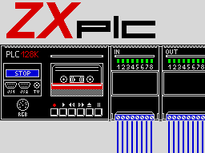

# ZX-PLC



A PLC programming environment for the **ZX Spectrum 128K** (also +2 / +2A / +3): editors for the three
IEC 61131-3 languages IL, LD and FBD, a compiler and a simulator, written in Z80 assembler. Programs are
not downloaded to a real PLC; they run in the built-in simulation with live monitoring.

**[User manual with screenshots](docs/MANUAL.md)** · **[Download (releases)](https://github.com/Pomaser/zx_plc/releases)**

## What it does

* **Three languages:**
  * Instruction List: a line editor with syntax checking.
  * Ladder Diagram: contacts, coils, branches, boxes.
  * Function Block Diagram: blocks nest and make room for themselves.
* **Up to 8 POUs per project:** MAIN calls the others. A project holds up to 12 KB.
* **Standard function blocks:** TON / TOF / TP timers, CTU / CTD counters, R_TRIG / F_TRIG, SR / RS. Also
  word compare and arithmetic (GT … LT, ADD, SUB, MUL, DIV, MOVE), step flags for sequences, system flags
  and clock pulses.
* **Simulation:**
  * a scan every 50th of a second, 16 inputs and 16 outputs on an LED panel;
  * live colouring of the program in all three languages;
  * a watch / force table, step and reset.
* **Symbols:** names and comments for every address, used everywhere instead of addresses.
* **A demo project** (traffic light in IL, pump and fan in LD, valve and horn in FBD) opens at the start.

## Unusual for a Spectrum program

* **A windowed user interface:**
  * a proportional 6x8 font (up to 42 characters per line);
  * drop-down menus with hotkeys and check marks;
  * pop-up windows that restore the screen under them;
  * a status bar with the symbol and comment of the item under the cursor.
* **Kempston mouse:** detected automatically and switched on in the menu. A pointer, and clicks in menus,
  lists, all editors and on the simulator's LEDs.
* **Comfort of a modern IDE:**
  * mark / copy / cut / paste, also between POUs;
  * undo, duplicate a POU;
  * cross references with a jump to each use;
  * Run puts the cursor on the line or element of a compile error.
* **A real compiler:** IL, LD and FBD are compiled to bytecode for a small virtual machine. LD and FBD go
  column by column, like a PLC evaluates a rung.
* **The whole 128K in use:**
  * the editors, compilers, VM and tools are spread over the paged memory banks, with calls between them;
  * a small core, the runtime data and the 12 KB project stay in fixed memory.
* **AY sound:** a soft key click and warning tones, played by the interrupt so that the program never waits.
* **Tape:**
  * projects are saved and loaded as standard ROM-format files, with a safe fallback when loading fails;
  * the program tape is packed with ZX0 and loads in under 4 minutes;
  * an animated loading screen (the PLC switches from STOP to RUN, its LEDs blink).

## Running it

* **Real Spectrum 128K:** load `zxplc.tap` with *Tape Loader* (or `LOAD ""`), then press a key.
* **Emulators:** use `zxplc.sna` (e.g. Fuse).

The [manual](docs/MANUAL.md) describes every screen and key.

## Building

```
make            # zxplc.sna   (make run: start it in Fuse)
make tap        # zxplc.tap   (BASIC + loader, blocks packed with ZX0)
make test       # automated tests, run headless
make docs       # screenshots of the manual
```

* **Requirements:** `sjasmplus` (≥ 1.18), Python 3 and a C compiler (for the ZX0 packer).
* **Tests and screenshots** need the Python package `z80`:
  `python3 -m venv .scratch/venv && .scratch/venv/bin/pip install z80`.

`tools/zxrun.py` is a small headless 48K / 128K emulator with tape and Kempston mouse for tests and
screenshots. `CLAUDE.md` describes the source structure and memory layout.
